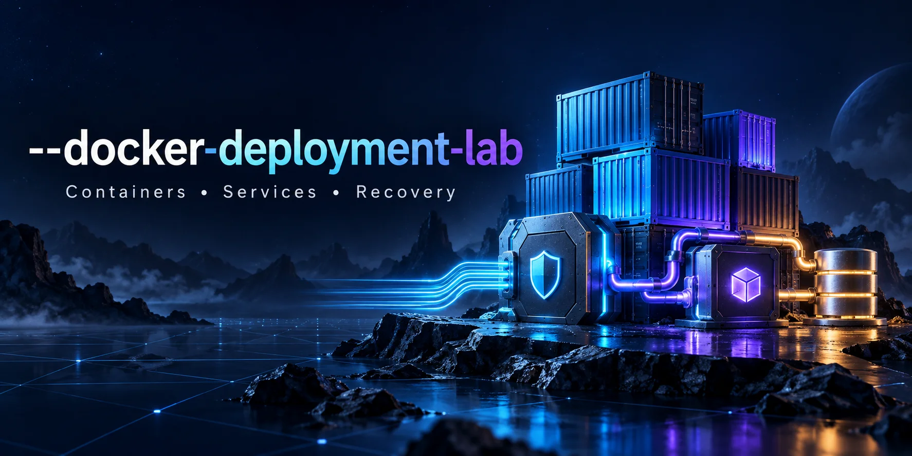

# Docker Deployment Lab



A three-service operations checklist application: Nginx → Python API → PostgreSQL. Create a check, list the latest 100 records, and resolve an item. 

## Start

Requires Docker Engine or Docker Desktop and Docker Compose v2 with `up --wait` support. Initial startup needs internet access to pull images and install the pinned Python dependency.

```bash
cp .env.example .env
# Edit .env: replace DB_PASSWORD with a unique local password.
docker compose config --quiet
docker compose up --build -d --wait
```

Open http://127.0.0.1:8088. Do not commit `.env`; `.gitignore` excludes it. PostgreSQL initializes the schema only on the first startup of its data volume. Changing the password in `.env` alone will not rotate the password in an existing database.

## Architecture and behavior

| Service | Purpose | Access |
| --- | --- | --- |
| `nginx` | Static UI and reverse proxy | Host loopback port 8088 |
| `api` | Validated JSON API, parameterized SQL | Internal port 8000 |
| `db` | Persistent operational checks | Internal PostgreSQL network only |

The API runs as a non-root user with a read-only container filesystem, dropped capabilities, and no new privileges. The database uses a named volume and has no published host port. The API joins both the web and database networks; Nginx cannot directly reach the database. Host loopback binding is the main access boundary. There is no login or TLS, so keep this lab local or access it through an SSH tunnel.

| Endpoint | Result |
| --- | --- |
| `GET /health/live` | 200 while the API process is responding |
| `GET /health/ready` | 200 if a database/schema query succeeds; otherwise 503 |
| `GET /api/checks` | Latest 100 checks, newest first |
| `POST /api/checks` with `{"title":"Check backups"}` | Create a check; 201 |
| `POST /api/checks/1/resolve` with `{}` | Resolve check 1; 200 or 404 |

Titles must be 1–160 non-whitespace characters after trimming. POST requests require JSON, with a 4 KiB API body limit. The database also enforces title and status constraints. Errors return generic responses instead of database credentials. UI content uses text nodes rather than inserting record titles as HTML.

## Verify the running stack

```bash
python3 smoke_test.py
```

The smoke test creates a real record, reads it back, and resolves it. Its test record remains in the database, labeled as a smoke test. Use `--base-url` to select another local port.

```bash
curl http://127.0.0.1:8088/health/live
curl http://127.0.0.1:8088/health/ready
docker compose ps
docker compose logs --tail=50 api db nginx
```

## Failure and recovery exercise

1. Create a check in the browser.
2. Run `docker compose stop db`. Readiness should fail while liveness remains available. Database connection timeouts can take a few seconds.
3. Run `docker compose start db`. Retry readiness and refresh the UI; the record should return.
4. Run `docker compose restart api`. Refresh the page and verify that database records survive the API restart.

Compose startup dependencies gate initial startup; they do not restart dependents on every health transition. A container marked unhealthy is not automatically restarted just because its health check fails. Restart policies handle process exits. This distinction is part of the lab.

## Database dump and restore exercise

Use an empty exercise database on the **same lab PostgreSQL instance**, avoiding changes to the active database:

```bash
mkdir -p backups
chmod 700 backups
umask 077
docker compose exec -T db pg_dump -U operations -d operations > backups/operations.sql
docker compose exec -T db createdb -U operations operations_restore
docker compose exec -T db psql -v ON_ERROR_STOP=1 -U operations -d operations_restore < backups/operations.sql
docker compose exec -T db psql -U operations -d operations_restore -c 'SELECT id, title, status FROM checks;'
```

Check that the dump command succeeded before restoring. `createdb` should fail if the exercise database already exists; choose a fresh exercise database name rather than overwriting it. Backups are ignored by Git. The exercise demonstrates logical restoration, not offsite disaster recovery.

Stop with `docker compose down`; records remain in the named volume. Avoid `down -v` unless you deliberately intend to delete the lab database.

## Tests and CI

```bash
python3 -m unittest discover -s tests -v
```

Five HTTP tests run with an in-memory test double, covering create/list/resolve, malformed inputs, size limits, missing routes/items, and liveness versus readiness during a simulated database outage. They do not exercise the PostgreSQL driver, SQL schema, Nginx, or Docker networking.

The GitHub Actions workflow additionally builds the Compose stack, waits for readiness, and runs the real HTTP smoke test. Workflow configuration is included but has not run before publication. Docker is unavailable in the preparation environment; a full end-to-end run remains required. The dependency is pinned, but base images are floating tags, not digest-pinned production builds.

## What this demonstrates

Container networking, service health, persistent storage, least-privilege API execution, environment-based configuration, HTTP input validation, reverse proxying, SQL parameters, and an operational recovery runbook. It does not claim production hardening or professional deployment history.
